# DEEP FIELD

DEEP FIELD turns the M-VAVE FM-1 into an ambient drone machine. Each key you press starts a *voice*: a note that
swells in, keeps sounding, slowly breathes and drifts, and fades out when you stop it. Up to eight voices play at
once.

- The four knobs on the HOME page shape every voice at the same time.
- Hold a voice's key and the knobs set that voice alone: its level, tone, tuning, and whether GEN may move it.
- GEN (generate) moves the voices to nearby notes on its own, or runs an arpeggio over them.
- Thirteen models, from eight breathing harmonics to wavetables, four-operator FM, hard sync, a worn tape loop and
  a singing bowl.
- The reverb can freeze and shimmer.
- A preset is a sound: change preset and your chord keeps playing while the sound morphs under it.
- MIDI comes in over USB, Bluetooth and the TRS jack, and goes out over USB and Bluetooth.

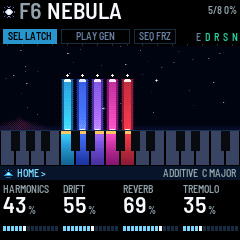

---

## Contents

1. Install
2. The first minute
3. The screen and the lights
4. The keys: voices, LATCH, the scale
5. The four macros (HOME)
6. The pages
7. GEN
8. FREEZE and the effects
9. Presets: changing and saving
10. MIDI and Bluetooth
11. The screen reader
12. Troubleshooting

---

## 1. Install

**From the browser:** open the installer page in Chrome or Edge and connect the FM-1 by USB. The installer can
also put M-VAVE's own firmware back.

**From a terminal:** download the firmware file (deepfield-X.Y.fwsc, where X.Y is the version) from the site,
connect the FM-1 by USB, and run `python3 base/tools/fm1_install.py deepfield-X.Y.fwsc` in a copy of DEEP FIELD's
source code (github.com/WisestWizard/deepfield).

If an install asks for update mode, hold REC while you switch the FM-1 on.

Installing is at your own risk. If the FM-1 only shows up as a disk called `WL82 UBOOT1.00`, the rescue tool
`fm1_rescue` (from felucca-bsp) recovers it.

---

## 2. The first minute

Some of the FM-1's buttons do something other than their printed name: SEL is LATCH, PLAY runs GEN, SEQ is
FREEZE, REC is Bluetooth, and ARP opens GEN's page (it doesn't start an arpeggio by itself). SEL is a button and
SELECT is a knob: they are different controls.

1. Switch on. The name appears over a vortex and falls into it along a spiral, letter by letter; after about three
   seconds the screen below takes over (press anything to skip it). The preset F1 FIRST LIGHT loads in silence:
   nothing plays until you press a key. SEL is lit, which means LATCH is on: each key you press keeps sounding.

   

2. Press a few keys, one at a time. Each one swells in and stays, shown on the screen as a beam over its key. Its
   key lights up and its beam rises.
3. Tap one of those keys again. That voice fades out as you let go, and its beam sinks. (Hold it and turn a knob
   instead, and the knobs set that voice alone: section 4.)
4. Turn KNOB 1 (TIMBRE): every voice gets brighter or darker. Turn KNOB 3 (REVERB): they sink further into the
   reverb. The four boxes along the bottom of the screen are the four knobs.
5. Press PLAY. GEN starts and PLAY lights green. Every few seconds one voice slides to a nearby note in the
   scale: watch its beam move.
6. Press SEQ. FREEZE turns on (FRZ lights): the reverb holds what it has. Press SEQ again to let it go.
7. Turn PRESETS. The preset names scroll past with a line filling under them. Stop, and when the line is full the
   preset's sound blends in over four seconds, under the chord you are playing. With nothing latched, the preset
   brings its own chord as well (section 9).
8. Hold SEL for a second: every voice stops. Then tap SEL: LATCH turns off, and the keys play leads, notes that
   sound only while you hold them (section 4).

---

## 3. The screen and the lights

The screen is laid out like the panel. The strip of keys on the screen matches your keys, and the four boxes at
the bottom match the four knobs. Only sound gives off light: the voices glow, and everything around them stays
dark. Each colour has one meaning:

| Colour | Means |
| --- | --- |
| A voice's own colour | That voice (by its note): its beam, its key on the strip, its band when open |
| Sun (warm gold) | Latched: a spark over the beam, a cap on the key, a bar under a locked voice |
| White | Your hand: a lead, the voice you have open |
| Cyan | Where you are: the page band, the bars, the morph line |
| Teal | An effect that is on |
| Orange | Something to look at: unsaved changes, LOAD, a failed save |

**Key lights** have three levels, one meaning each:

- **Bright:** a voice sounds on this key, and the key is how you reach it: tap it to stop the voice, or hold it and
  turn a knob to set the voice alone (section 4). When GEN or SEL moves a voice, its light moves with it. A lead's
  key is bright while you hold it (a lead is a note played with LATCH off: section 4).
- **Half:** sound that is going, or not yours to touch: a voice fading out, the latched voices (the held chord) while LATCH
  is off, a lead fading out.
- **Glow:** a note in the scale. With the scale set to CHROMATIC, nothing glows.

A voice above or below the keys lights none of them.

A lead's key blinks off for an instant each time it is struck, so you can see every step of an arpeggio, or an
accent on a key that is already lit. While FX is held, the keys show the effect switches instead (section 8).

**Button lights:**

- The open page's button is lit (half-lit while FX is held).
- SEL is lit while LATCH is on, SEQ while FREEZE is on.
- SAVE is lit while the sound or a setting (GLOBAL, MIDI or USB page) has changed since the last save, and blinks
  in the save dialog. Changing preset, LATCH or the octave doesn't light it, though a save keeps them too.
- PLAY shows GEN's mode by its colour: green for WALK, red for ARP, and orange (green and red together) for the
  others. It blinks at each RANDOM move and each ARP step.
- OCT- or OCT+ is half-lit one octave from the middle, fully lit two octaves from it.
- SEL held blinks after a third of a second until, at a second, it stops every voice (unless you touched a key
  meanwhile: section 4); HOME held blinks until, at a second, it puts the preset back as saved (section 9); REC held
  blinks until it switches Bluetooth.

| Part | What it shows |
| --- | --- |
| Header | The model's glyph, then the preset's slot (F1–F16, U1–U16) and name, with a small orange square after it while it has unsaved changes. On the right: OCT when the octave isn't zero; USB while a computer records (USB MUTE when the speaker is silenced, section 10); BLE when a computer, phone or tablet is connected over Bluetooth; DEV when the FM-1 is connected to a Bluetooth MIDI keyboard or controller; how many voices are sounding; and how busy the processor is (LOAD in orange: see Troubleshooting). Below that, three pills named for their buttons, SEL LATCH (SEL TRANS while SEL held is moving the chord), PLAY GEN and SEQ FRZ, filled while on, always in the same places (while GEN runs, a white line fills along the foot of its pill toward the next move); the letters E D R S N, lit for the effects that are on (ensemble, delay, reverb, shimmer, noise); and a cyan line along the bottom edge while a preset blends in. |
| The view | The voices. Each voice is a beam of light rising from its key, in its key's colour, brightest at its foot, with a white-hot head that marks its level: you see it swell in and sink as it fades (dim), and it breathes with the voice. A latched beam has a sun spark over its head; a locked one a sun bar across its foot; an open one (section 4) white frames, with the other beams dimmed. An ARP step flashes its voice's head. When GEN moves a voice, its beam slides to the new key and leaves a mark where it started, and before the move a line reaches from its head toward a dotted ghost at the key it is going to. A voice above or below the keys (a MIDI note, or after an octave change) stands thin at the edge. The noise layer is a mound of mist where its band sits, warm when brown and pale when white, drifting with the noise's RATE and lifting with each gust. Stars drift at DRIFT's speed, each twinkling slowly on its own, over a faint horizon; FREEZE stills all of it and puts ice brackets in the corners. Turning a knob shows its name, its value large and its bar here for a moment; the beams dim but stay in view behind it. Messages such as LATCH OFF, GEN ON or SAVED appear here too, and so does the list of presets while PRESETS turns (section 9). While FX is held, the five effect switches are shown here in a row. |
| The keys strip | All 27 keys as dark glass, lit only by sound: a sounding voice's key glows in its colour, bright at the top and dimming down the key (dim while it fades), with a sun cap when latched; the keys of the scale are slightly lighter glass; a lead's key is white (grey as it fades); the held chord's keys are dim while LATCH is off; a voice's key is the one it sounds on, so it moves when GEN or SEL moves the voice; the voice you have open is framed white. |
| Footer | The page band: the icon of the button that opened the page, its name, the page's name, and `<` `>` where SELECT can go, with the model, the scale and its root on the right. Below it, the four knobs in the order of the real knobs: each name, its value (a number large with its unit small, or a word), and a bar that shows the kind of value: segments filling for an amount, one cell per choice for a list, two cells for an on/off switch, hits and rests for EUCLID. TIMBRE, SHAPE and NOISE are named for what they do on each model (section 6). While a voice is open, the band reads VOICE and its note in the voice's colour, and the four knobs are its own (section 4). |

---

## 4. The keys: voices, LATCH, the scale

A **voice** is one sounding note, and up to eight sound at once. A key starts a voice at its note, and the voice swells in
over ATTACK seconds (ENVELOPE page). Aftertouch, pressing harder on a key once it is down, makes its voice brighter and
adds vibrato for as long as you press; AFTERTOUCH (ENVELOPE page) sets how much. The top seven keys (C#5 to G5) have
no aftertouch.

With **VELOCITY** off (the default, on the MIDI page), every key starts its voice at the same level, so chords are
even. With it on, how hard you strike a key sets its voice's level. MIDI notes always use their own velocity.

If you start a ninth voice, one fades out quickly to make room: a voice that is already fading if there is one, or
else the oldest.

**LATCH** (SEL, lit while on; on by default): a voice keeps sounding after you let go of its key. Tap the key it
sounds on to stop it (after GEN moves a voice, its new, lit key): it fades out over RELEASE seconds from when you let
go. However slowly you press, letting go stops the voice, unless you turned a knob while the key was down. A latched key has a sun cap on the screen's
keys strip, and its beam a sun spark over its head. Hold SEL for a second to stop every voice (the screen says ALL NOTES OFF). Bringing in a
preset's chord (section 9) latches its voices and turns LATCH on.

**A voice's own values.** With LATCH on, each latched voice can be set apart from the others:

1. Hold the key the voice sounds on (its lit key).
2. Turn a knob. The voice opens: the footer reads VOICE and its note, its beam and its key get a white frame, and the
   other beams dim. That first turn already sets the value.
3. The four knobs are now that voice's own:
   - **LEVEL**: -24 to +6 dB, one dB a click, and MUTE below -24. A muted voice stays latched and silent, so ARP and
     GEN still use its note.
   - **TONE**: the voice's own TIMBRE, -50% to +50%: a dark root under a bright top.
   - **TUNE**: -50 to +50 cents, a cent a click. A few cents on a fifth makes it beat slowly; -14 cents on a major
     third makes it pure.
   - **LOCK**: turn right for ON, left for OFF. GEN never moves a locked voice, STRUM never dips it, and ARP
     leaves it out, so SHIFT and PROG move the rest of the chord over it like a pedal note. Moving the chord with
     SEL still moves it. A sun bar across the foot of its beam marks it.
4. Let go of the key. The footer goes back to the page you were on, and the voice keeps its values and keeps
   sounding. SAVE lights.

Hold several latched keys and the knobs move all of those voices together, each from where it is. The values travel
with the voice when GEN or SEL moves it, and are saved with the preset. Over MIDI they go out as NRPN (section
11), so a computer can record them.

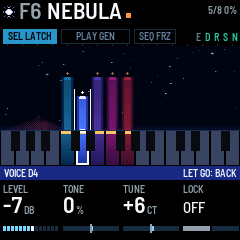

**Playing leads over the held chord.** Tap SEL to turn LATCH off (the screen says LATCH OFF, KEYS PLAY). The voices that
were latched keep sounding: the *held chord*. The keys now play **leads** over it. A lead is a note in the preset's
own sound that plays while you hold its key and fades when you let go. Leads never latch, and GEN never moves
them. A key whose note is already latched plays a lead on top of its voice, as an accent. Up to four leads play at
once; a fifth replaces the oldest. On the screen a lead is a thin white beam, and its key is white on the keys
strip. Tap SEL again to go back to LATCH.

MIDI notes work the same way: with LATCH on, a MIDI note plays a voice that sounds until its note off (it never
latches); with LATCH off, it plays a lead.

The LEAD page (ENV, then SELECT) shapes the leads: ATTACK (1 ms to 2 s), RELEASE (30 ms to 7.7 s), TRANSPOSE (up to two
octaves higher, in semitones) and LEVEL (the default, 59%, sits about 2 dB over a voice, so a lead stands out over the held chord;
50% matches a voice; 100% is 9 dB louder).

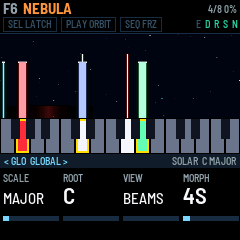

**Moving the chord.** Hold SEL and touch a key: the whole latched chord moves there, its lowest note to that key and
the other notes keeping their distance above it. While SEL is down, each key you touch moves it again; the pill
reads SEL TRANS and the screen says TRANSPOSE and the note. The voices glide over GLIDE (ENVELOPE page), and their
lights move with them. Let go of SEL and the keys strike voices again (or play leads, with LATCH off), LATCH as it
was. Over MIDI, the old notes are switched off and the new ones on. Holding SEL for a second without touching a key
stops every voice instead; after that the keys strike again, even before you let go of SEL.

**The scale.** SCALE on the GLOBAL page picks the scale: CHROMATIC, MAJOR, MINOR, DORIAN, PHRYGIAN, LYDIAN, MIXOLYDIAN,
MAJ PENTA (major pentatonic), MIN PENTA (minor pentatonic), WHOLE TONE or HARM MINOR (harmonic minor). ROOT picks its root note.
Every key, black keys included, always plays its own note. The scale does two things: its notes glow on the keys,
and GEN only moves voices to notes in it.

**OCT- and OCT+** move the keys down or up an octave, up to two octaves each way. The header shows OCT and the
number.

---

## 5. The four macros (HOME)

HOME is the main page. Its four knobs, TIMBRE, DRIFT, REVERB and TREMOLO, are the four macros: each one shapes every voice
at once.

| Knob | Name | What it does |
| --- | --- | --- |
| KNOB 1 | TIMBRE | How full and bright the sound is. What it changes depends on the model: on ADDITIVE, how many harmonics and how bright; on SUPERSAW, the filter cutoff (shown in Hz); on FM and FM 4-OP, the FM depth; on BOWED, the string's brightness; on WAVETABLE, a filter that follows the note. The screen names it for the model (section 6). Aftertouch adds to it for that voice, and so does the voice's own TONE. |
| KNOB 2 | DRIFT | How much everything wanders: the detuning, the slow drift of pitch, the vibrato, the breathing of the harmonics, and how fast the stars move on the screen. |
| KNOB 3 | REVERB | How much reverb, and a little delay. The dry sound stays as it is. |
| KNOB 4 | TREMOLO | How much each voice fades down and back up on its own slow cycle. At full, each voice goes all the way to silence and back. TREM RATE (LFO page) sets how fast. |

MASTER is the volume of the speaker and headphones. It is gentle at the bottom so headphones stay usable: a third
of the way up is about 29 dB under full, halfway about 18 dB under, three quarters about 7 dB under. At full, the
loudest playing still stops 6 dB short of the top of the output, so nothing clips.

---

## 6. The pages

Each button opens its page, and the four knobs then set that page's four values, shown along the bottom of the
screen. A button always opens the same page, and its light shows which page is open. Turn SELECT to step to the
next or previous page, in the order of the table below: DELAY, DELAY 2 and REVERB are one, two and three steps
after ENSEMBLE, for example. The page band's `<` and `>` show where SELECT can go. A page stays open until you
press another page button or turn SELECT. Most values show on the screen as a percentage.

**Turning the knobs.** Turned slowly, a knob moves in small steps: about 43 clicks from one end to the other. Turned
quickly, in big ones: 16 clicks end to end. SUPERSAW's TIMBRE, a free DLY TIME and ATTACK move in finer steps still, and
TEMPO one BPM a click. A knob with only a few values (RANGE, VOICES, TRANSPOSE, the delay's note lengths,
FM 4-OP's patches) moves one value a click at any speed.

A few names are on two pages (ATTACK and RELEASE on ENVELOPE and LEAD, RATE on NOISE and GEN, GATE on DELAY 2 and
ARP): the page band tells you which one you are turning.

| Button | Page | KNOB 1 | KNOB 2 | KNOB 3 | KNOB 4 |
| --- | --- | --- | --- | --- | --- |
| HOME | HOME | TIMBRE | DRIFT | REVERB | TREMOLO |
| EDIT | OSC | MODEL (also on ALGORITHM) | SHAPE (named for the model) | SUB | NOISE (named for the model) |
| EDIT, SELECT once | NOISE | LEVEL (0 is off) | COLOR (brown to white) | RATE (how fast it moves, how often it gusts) | BANDPASS (wide, narrow, or on the voices: see below) |
| ENV | ENVELOPE | ATTACK (fade-in, 30 ms to 20 s) | RELEASE (fade-out, 30 ms to 20 s) | AFTERTOUCH (how much pressing harder brightens) | GLIDE (how long a GEN move or a transpose takes; 0.13 s on the factory presets) |
| ENV, SELECT once | LEAD | ATTACK (1 ms to 2 s) | RELEASE (30 ms to 7.7 s) | TRANSPOSE (0 to +2 octaves, in semitones) | LEVEL |
| LFO | LFO | TREM RATE | VIBRATO | RANDOM (a slow random drift of pitch) | WIDTH (stereo spread across the notes) |
| FX | ENSEMBLE | ENSEMBLE (OFF, CHOR I, CHOR II or ENSEMBLE, the fullest) | ENS MIX | – | – |
| FX, SELECT once | DELAY | TYPE (PING PONG, TAPE, MULTI TAP, REVERSE, OCT UP, OCT DOWN, GRANULAR) | DLY TIME | DLY FDBK (how many repeats) | DLY MIX (how loud) |
| FX, SELECT twice | DELAY 2 | TONE (dark or bright repeats) | DIFFUSION (echoes blurred into a cloud) | WOW (how far the tape wanders) | GATE (only slices of the sound go in) |
| FX, SELECT three times | REVERB | DECAY (how long it rings, about 0.6 to 8 s) | DAMPING (how fast the highs die away) | SHIMMER | REVERB (the same as on HOME) |
| ARP | GEN | MODE | Depends on the mode (section 7) | Depends on the mode | Depends on the mode |
| ARP, SELECT once | GEN 2 | RETURN | OCTAVES (ARP, 1 to 3) | EUCLID (ARP: its hits and rests) | DIV (ARP: a step's length) |
| GLO | GLOBAL | SCALE | ROOT | MORPH (NOW, or 1 to 30 s) | – |
| GLO, SELECT once | MIDI | IN CH (OMNI or 1–16) | OUT CH (1–16) | LOCAL | VELOCITY |
| GLO, SELECT twice | USB | SPEAKER (ON, AUTO, OFF) | USB LEVEL (the recording's level, 0 to -18 dB) | CLOCK OUT | – |

**The models** (turn ALGORITHM, or KNOB 1 on OSC). A new model crosses every voice over in under a second, the new
sound rising as the old one fades, as a preset in another model does over MORPH (section 9).

TIMBRE (HOME), SHAPE and the fourth OSC knob do something different on each model, so the screen names each one
for what it does there: TIMBRE reads CUTOFF on SUPERSAW, FM AMOUNT on FM, and so on. A knob a model doesn't use is
empty. In this manual, and over MIDI, they are TIMBRE, SHAPE and NOISE.

| Model | What it is | TIMBRE (HOME, KNOB 1) | SHAPE (OSC, KNOB 2) |
| --- | --- | --- | --- |
| ADDITIVE | Eight harmonics, each breathing on its own | HARMONICS: more harmonics, brighter | ODD/EVEN: odd harmonics (hollow), then all of them, then even ones (like an organ) |
| SUPERSAW | Three detuned saws and a sub through a dark filter | CUTOFF: the filter cutoff | DETUNE: how far apart the saws are tuned |
| FM | Two-operator FM with a breathing depth and a detuned second carrier | FM AMOUNT: the FM depth | RATIO: 1, 2, 3, 3.5, 4, 5, 7 or 1.41 |
| BOWED | A bowed string | BRIGHTNESS | None (the knob is empty) |
| FORMANT | A buzz through three vowel formants | FORMANT: moves the formants up and brings the upper two forward | VOWEL: A, E, I, O, U |
| BELL | Four partials, each breathing on its own | BRIGHTNESS: brighter upper partials | INHARMONIC: from the harmonic series to a bell's ratios |
| SHEPARD | Six octaves of sine under a moving window: a rise or fall that never ends | CENTER: leans the window high or low | RISE/FALL: still at the middle; below it falls, above it rises, faster further from the middle |
| WAVEFOLD | A sine through a wavefolder (DRIFT makes the fold breathe) | CUTOFF: the filter after the fold | FOLD: how hard it folds |
| WAVETABLE | Pocket Poly's three wavetables in one sweep: ANALOG (sine to saw, square and a narrow pulse), VOX (vowels), GLASS (a bright cluster that climbs). DRIFT lets each voice's place wander. | CUTOFF: a filter that follows the note; the level stays the same | POSITION: where in the sweep; the screen names the table and its frame (ANALOG 1 to GLASS 16) |
| FM 4-OP | Four-operator FM after Pocket Poly's FM engine. Its envelopes run at ATTACK's pace, so a slow ATTACK evolves the timbre slowly. DRIFT breathes the brightness. | FM AMOUNT: the FM depth | PATCH, one a click: GLASS PAD, BRASS, ORGAN, BELL PAD, E.PIANO, WOOD, STRINGS, CLUSTER |
| SYNC | A saw hard-synced to the note (Pocket Poly's sync, with every edge smoothed so it stays clean up high): the snarl of a sync sweep. DRIFT breathes the ratio, so the sound's formant slides. | CUTOFF: a filter that follows the note, and a little drive | RATIO: the synced saw's speed against the note, X1.0 to X8.0 |
| TAPE | A loop on worn tape: wow (a slow sway in pitch, its own for each voice), flutter, and now and then a dropout, the sound sinking and darkening for a third of a second. DRIFT is how worn it is: more wow, more dropouts. Everything saturates a little. | BANDWIDTH: the tape's bandwidth | SOURCE: the sound on the tape, a soft organ (0%) to a saw (100%) |
| RESONATOR | Noise played into five resonances over the note, like a singing bowl or a glass kept ringing: it sustains, shimmering as the noise moves through it. DRIFT adds a slow shimmer in their tuning. | BRIGHTNESS: how bright the upper resonances ring | MATERIAL: PURE (in tune with the note's harmonics), GLASS, BOWL, then BRONZE (a gong's crowded tones) |

SUB adds an octave below on every model. The fourth OSC knob (NOISE) adds breath, noise or an edge: BOW NOISE on
BOWED, BREATH on FORMANT, STRIKE (the hiss of the strike) on BELL, NOISE (a breath of it) on SHEPARD, NOISE into the
fold on WAVEFOLD, UNISON on WAVETABLE (a second, detuned copy from another place in the sweep), FEEDBACK on FM 4-OP
(grit), RING MOD on SYNC (the sound rung with the note's sine: hollow, metallic, still in tune), HISS on TAPE, and
NOISE on RESONATOR (the scrape: raw noise, and the resonances wider). ADDITIVE, SUPERSAW and FM have no fourth knob.

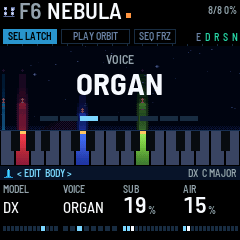

**The noise layer** (EDIT, then SELECT for NOISE) is a stereo noise under the voices,
or on its own with no keys held: wind, sea, rain or breath.

- **LEVEL** turns it on and sets how loud it is (0 is off).
- **COLOR** runs from brown (a deep rumble, down to 25 Hz) to white.
- **RATE** sets how fast the noise moves and how often a gust comes.
- **BANDPASS**: at 0, wide open. Up to the middle, a band that narrows onto the newest note. Past the middle, narrow
  bands on the four loudest voices, each as loud as its voice, so the noise becomes air through the chord.
- Each preset also sets four noise values that have no page: its TYPE (hiss, rain or crackle), its GUSTs (now
  and then, at RATE's pace, it swells louder, brighter and higher, sitting lower between; FREEZE holds the weather),
  how far it DUCKs under a chord, and its WIDTH. A preset you save keeps those of the preset it came from.

The four macros shape the noise too: TIMBRE brightens it, DRIFT widens its wander, REVERB sends it to the reverb, and
TREMOLO makes it breathe. Aftertouch brightens it, and it fades in and out at ATTACK and RELEASE like a voice. Hold
FX and press C4 (white key 5) to switch it off and on again. Switched back on, it returns at the level it had when
you last switched it off, or else at the preset's saved level, or else at a third. N lights in the header while it is
on, and its beam on the screen rises with each gust. MIDI CC 20 sets its LEVEL.

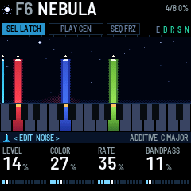

Each preset also sets, with no page, how unlike each other its voices are: each voice's own small detune, TIMBRE and
place in the stereo field (SPREAD), pairs bending each other's pitch (CROSS MOD), each voice's TIMBRE wandering (TIMBRE DRIFT)
and each drifting across the stereo field (PAN DRIFT). A preset you save keeps those of the preset it came from.

**The delay.** DLY FDBK sets how many repeats and DLY MIX how loud they are; above about 60 % DLY MIX climbs
faster, so at full the first echo is about as loud as the note. **TYPE** (the first knob on DELAY) chooses what kind
of delay it is:

| TYPE | What you hear |
|---|---|
| PING PONG | Left, then right, then left again, each repeat a little further away. The right-hand echo comes a little later than the left one, so the repeats never fall into a pattern. |
| TAPE | One echo in the middle, darker and grittier each time round, its pitch swaying (about 22 cents either way at WOW's default, more as WOW rises), so even over a held chord you hear it waver and beat. |
| MULTI TAP | Three echoes for every one: at a third, two thirds and the whole of DLY TIME, left, centre and right. One note becomes a rhythm; a held chord comes back as a pulsing triplet, left, centre, right, because only a slice of it goes in each DLY TIME (a note you play goes in whole). |
| REVERSE | Each echo plays backwards: a note's echo swells up to where it started. Each backward swell rises and is cut, from alternate sides, so a held chord breathes in once every DLY TIME. |
| OCT UP | Each echo an octave higher than the last, climbing out of the drone and thinning as it goes. |
| OCT DOWN | Each echo an octave lower, sinking under the drone. |
| GRANULAR | Short pieces (40 to 150 ms) of the last two seconds, two every DLY TIME, scattered left and right, each at the note, an octave up or down, or a fifth up: a held chord turns into a glittering cloud of itself, a played note comes back in pieces. |

Turning TYPE fades the echoes out and starts the new kind fresh.

A held drone hides a plain echo: an echo of a steady sound is the same steady sound. So each kind changes what comes
back: PING PONG moves left and right, TAPE wavers, MULTI TAP pulses, REVERSE breathes, OCT UP and OCT DOWN change octave, GRANULAR
glitters. GATE and WOW help on all of them. To hear a kind on its own, play short notes with LATCH off and no chord
held, REVERB down.

- Over most of its turn, **DLY TIME** is a time from 50 to 800 ms, and the screen shows it in ms. On PING PONG the
  right-hand echo comes a little later than the left one, up to 1.1 s.
- Near the top of its turn, DLY TIME becomes a note length: 1/16, 1/8, 1/4T, 1/8D, 1/4, 1/4D or 1/2 (T is a
  triplet, D is dotted). The tempo comes from TEMPO (ARP's tempo, on the GEN page with MODE set to ARP), or from
  MIDI clock when it is coming in, so the echoes land in time with ARP; on PING PONG the right-hand echo then lands on the
  beat too. A length that would be longer than 800 ms at that tempo plays at half length, still in time. On GRANULAR,
  DLY TIME is how often a piece comes.
- **TONE** (DELAY 2) filters the repeats: low, they get darker and stay full; high, they get thinner and
  brighter, so they stand apart from the drone.
- **DIFFUSION** (DELAY 2) blurs each repeat: at 0 a clean tape echo, past the middle a short burst, at full a cloud
  that trails the drone instead of repeating it.
- **WOW** (DELAY 2) sets how far the tape's pitch wanders: at 0 clean, at about a third the gentle wander the delay
  always had, at full seasick. A wandering echo goes slightly out of tune with the drone, and you hear it beat.
- **GATE** (DELAY 2) lets only slices of the sound into the delay, one at the start of every DLY TIME: at 0
  everything goes in, at full a short slice. A held chord then comes back as a pulse of itself, in time with the
  delay. The slices are made louder as they get shorter, so the echoes stay as loud overall.
- Changing DLY TIME bends the pitch on its way, like tape.

---

## 7. GEN

GEN (generate) moves the latched voices by itself. Press PLAY to start it and again to stop it; when it stops, the voices
stay where they are. When it starts, the screen names the mode (WALK 5.1S, for example). While it runs, the
PLAY pill fills up toward the next move and flashes when it comes. The pill is named for the mode: PLAY GEN for
WALK, PLAY SHIFT, PLAY RANDOM and so on.

Pick the mode with KNOB 1 (MODE) on the GEN page: press ARP. KNOB 2 to KNOB 4 change with the mode,
and PLAY's colour shows it:

| Mode | PLAY | KNOB 2, 3, 4 | What happens |
| --- | --- | --- | --- |
| WALK | green | RATE, CHANCE, RANGE | Every RATE seconds (give or take a quarter), with a CHANCE, one voice moves to a nearby note in the scale, up to RANGE scale steps away. It never moves onto a note another voice is playing. |
| SHIFT | orange | RATE, CHANCE, RANGE | All the voices move together by the same number of scale steps, up to RANGE, so the whole chord shifts to a related one. |
| RANDOM | orange | RATE, VOICES, RANGE | Several voices move at once, each its own way, with looser timing (give or take a half). VOICES sets how many: one at 0, all the latched voices at full; the knob counts them, 2 OF 3 with three latched. |
| ARP | red | TEMPO, GATE, PATTERN | An arpeggio. The voices keep droning while a lead (section 4) steps through their notes. TEMPO is 40 to 240 BPM and DIV (GEN 2) how long a step is (an eighth note unless you change it). GATE is how long each step is held (smoothly joined at the top). PATTERN is UP (from the lowest), DOWN (from the highest), UP DOWN, RANDOM, or PLAYED (the order you struck them). OCTAVES (GEN 2) spreads it over more octaves, and EUCLID (GEN 2) puts rests between the notes. Add or let go a voice while it runs and it carries on from the note it just played. ARP remembers the notes, in the same PATTERN: stop every voice (hold SEL) and it keeps playing until you press PLAY. A locked voice is left out: it drones under the arpeggio. The pill fills over EUCLID's steps. |
| PROG | orange | RATE, CHANCE, CHORDS | The chord walks through a progression, picked with CHORDS (below). Each step is counted in scale degrees from where you played the chord. |
| LOOP | orange | RATE, DECAY, OCT JUMP | Your last eight leads (keys played with LATCH off, or MIDI notes then) come back as a phrase every RATE seconds, quieter each time, losing notes (DECAY) and jumping octaves (OCT JUMP) until it is gone. A new note starts it again with the new phrase. ARP's own notes don't count. |
| STRUM | orange | RATE, CHANCE, SPEED | Every RATE seconds, with a CHANCE, each voice dips and swells back at ATTACK speed, from low to high, SPEED apart: a slow strum across the chord. |

Every mode but ARP needs at least one latched voice: with none, nothing moves (so LOOP needs a held chord under the leads).
RANDOM and LOOP have no CHANCE knob, but they still use the CHANCE last set in another mode. A locked voice (section
4) is never moved.

**RATE** runs from 0.1 s to 60 s, shown in tenths of a second below ten. Under a second GEN stops changing the
chord and starts playing it: at half a second WALK and RANDOM make a slow melody inside the chord, and with GLIDE
longer than RATE the voices never land, a swarm. SHIFT that fast is mostly a blur. Under half a second the screen
stops showing where the moves go (they would only flicker). LOOP never runs faster than once a second: its phrase
needs the time.

**EUCLID** (GEN 2, for ARP) spreads the notes over a pattern of steps as evenly as they go, and rests on the
others: 8/8 (every step a note), 5/8, 3/8, 7/12, 5/12, 4/9, 7/16 or 5/16. The notes move on only at a note, so four
notes over five hits fall differently against the pattern every time round. **DIV** sets a step's length against
TEMPO's beat: 1/16, 1/16T, 1/8, 1/8T, 1/8D, 1/4, 1/4T, 1/2 or 1 BAR (T a triplet, D dotted). Slow steps with a long
RELEASE (LEAD page) toll like bells.

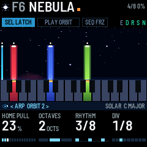

PROG's progressions: I IV V, I VI IV V, I V VI IV, I VI III VII, I IV I V, I II V, I III VI IV and I VII IV. They
are scale degrees, so in a minor key I IV V means i iv v.

**RETURN** (GEN 2) is the chance that a voice, or in SHIFT the whole chord, is pulled back to the key where it
started. GEN leaves alone the voices held over MIDI, the locked voices, and the leads. Each move goes out over MIDI as a note off and
a note on.

**Seeing where it goes.** GEN picks each move when the countdown starts, so you can see it coming. A line grows
from the top of the voice's beam toward the key it is going to, and a faint ghost beam stands at that key. When the
move comes, the beam slides along the line and the key's light moves with it: the voice is now reached from its new
key.

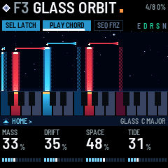

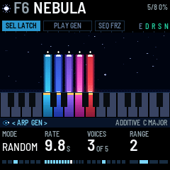

**MIDI clock.** While MIDI clock comes in (over USB, TRS or Bluetooth), ARP steps at DIV of it and TEMPO reads EXT;
RATE counts in whole beats of that tempo (or a half or a quarter of a beat, below one), so GEN's moves land in
time, and RATE reads in beats (4 BEATS, 1/2 BEAT) instead of seconds. The clock is followed from one input only: the
same clock arriving on a second one (a computer on USB and over Bluetooth at once) is not counted twice. The tempo is
read over a whole beat, so a clock that comes in bursts (a Bluetooth link) keeps time. A MIDI start restarts ARP.
After two seconds without clock, GEN goes back to its own timing. CLOCK OUT (USB page) sends clock, with start
and stop, while ARP runs from TEMPO, so a drum machine can follow the FM-1.

---

## 8. FREEZE and the effects

**FREEZE** (SEQ, lit while on): the reverb holds what it has, forever. Nothing new goes in, nothing dies away, and
it comes up to about the level of the dry sound. The voices keep playing on top, dry and through the delay. The
shimmer is silent while frozen. Press SEQ again to let it go. While it is frozen, four ice brackets stand in the
view's corners and the view holds still: the stars stop drifting and twinkling, the beams stop breathing, the mist
stops moving.

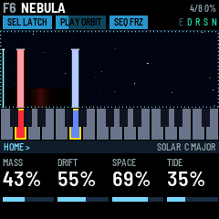

**SHIMMER** (REVERB page) feeds the reverb back into itself an octave higher: a rising cloud. It can't run away,
whatever the reverb's size.

**Switching effects on and off.** Hold FX, and the five lowest white keys become switches, on every preset:

| Key | Switches |
| --- | --- |
| F3 (white key 1) | Ensemble |
| G3 (white key 2) | Delay |
| A3 (white key 3) | Reverb |
| B3 (white key 4) | Shimmer |
| C4 (white key 5) | The noise layer |

Press a key to switch its effect on, and again to switch it off. Switched off, the delay and the reverb stop
taking in sound and let what they hold ring out, as a pedal's spillover does (a frozen reverb stops at once). An
effect the preset has at zero comes in at a useful amount: DLY MIX 27%, REVERB 35%, SHIMMER 23% (with the reverb), and ENSEMBLE CHOR I with ENS MIX at 31%. While
FX is held, the screen shows the five switches in a row, each ON or OFF (the noise with its level), and the keys of
the effects that are on light teal. The keys play no notes while FX is held. The switches are saved with the preset,
and E D R S N in the header show which effects are on. While an effect is off, its amount reads OFF on its knob
(REVERB, DLY MIX, ENS MIX, SHIMMER), and turning that knob switches the effect back on at the amount turned to.

Tap FX without pressing a key to open the effects pages instead: ENSEMBLE, then turn SELECT for DELAY, DELAY 2 and
REVERB, in the same order as the keys.

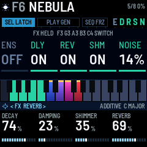

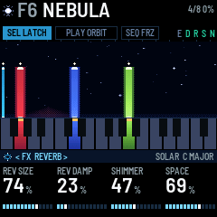

---

## 9. Presets: changing and saving

A preset is a sound. It holds the values on the sound pages (HOME, OSC, NOISE, ENVELOPE, LEAD, LFO, the effects
and GEN) and the effect switches. It also keeps a chord: the voices that were latched when it was saved, with
their own values (section 4). The GLOBAL, MIDI and USB pages are settings instead: they stay as they are when you
change preset. F1–F16 are the factory presets. U1–U16 are yours, and start with no chord.

**Changing preset.** Turn PRESETS. The view shows the preset you are turning to large, its neighbours on either side,
and all 32 slots as a row of marks (F1–F16, then U1–U16): the one you are on in cyan, the one you are turning to
tall and white. Nothing changes while you keep turning. A line fills along the foot of the view, and when it is
full (0.7 s after you stop) the preset lands, and its sound
blends in over MORPH seconds (GLOBAL page; 4 s by default, or NOW to switch at once). A bar along the bottom of the
header shows the blend.

- Your chord keeps sounding. If the new preset has another model, each voice crosses into it, the new sound rising as
  the old one fades. With eight voices there is no room to cross, so they switch one at a time, low to high, and
  the chord never drops out at once.
- LATCH, GEN (PLAY, its colour, and while it runs its page's values too), FREEZE, the octave and the scale stay as
  they are.
- A delay or reverb the new preset switches off rings out.
- A MIDI program change does the same, but never brings a chord.

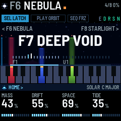

**Bringing in a preset's chord.** With nothing latched, PRESETS brings in the preset's chord with its sound: the screen
says PRESET + CHORD (+ CHORD in sun under the name in the list). Its voices come in latched, LATCH turns on, and its
GEN values come too. With a chord latched, PRESETS changes only the sound; to hear another preset's chord, hold SEL
for a second to stop yours first. To bring in the chord of the preset you are on, turn PRESETS one click forward and
back. A preset with no chord leaves your voices alone. Every factory chord is stored on C and plays in ROOT (GLOBAL page);
a chord you save plays in the ROOT it was saved in, moved to today's.

**Back to the preset as saved.** What you change on a preset stays until you save or change preset, and LATCH, GEN and
FREEZE carry over from preset to preset. To put the preset you are on back as it was saved, hold HOME for a second (it
blinks while it counts): its sound, its effect switches and its GEN values blend back in over MORPH, the screen says
its name and AS SAVED, and SAVE goes dark. Your chord keeps playing, and LATCH, GEN on or off, FREEZE, the octave and
the scale stay as they are. A tap on HOME still only opens the HOME page.

**Switching on.** The preset you were on loads in silence: its sound is ready, and nothing plays until you press a
key, or turn PRESETS to bring in a chord.

**Saving.**

1. Press SAVE. The screen says SAVE PRESET TO and a user slot.
2. Turn PRESETS (or SELECT, or KNOB 1) to choose U1–U16.
3. Press SAVE again. The sound and the voices latched right now (each with its own values, in the ROOT you are
   in) go into that slot, and the screen says SAVED. Press HOME instead to cancel.

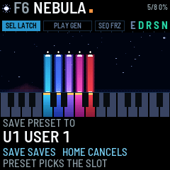

The saved preset takes the name of the preset you were playing, unless you save over the user slot you are on, which
keeps its name.

Every save also stores the settings: which preset you are on, the octave, scale, root, LATCH, VELOCITY, LOCAL,
MORPH, the MIDI channels, the USB page, and Bluetooth on or off. Nothing is stored until you save: switch off
without saving and all of it goes back to the last save.

**The factory presets** (their chords stand on C, in ROOT):

| Preset | Model | Sound |
| --- | --- | --- |
| F1 FIRST LIGHT | ADDITIVE | A warm major chord |
| F2 VOID TIDE | SUPERSAW | Low and breathing |
| F3 GLASS ORBIT | FM | Shimmer and delay; made for GEN |
| F4 BOWED SKY | BOWED | Wide |
| F5 PULSAR | FM | A fast tide |
| F6 NEBULA | ADDITIVE | Hollow, very slow swells, drowned in reverb, a wind bed |
| F7 DEEP VOID | SUPERSAW | Sub and a long delay over a quiet crackle |
| F8 STARLIGHT | BOWED | Bright, airy, high |
| F9 CATHEDRAL | FORMANT | An open vowel in a big hall |
| F10 LOW CHOIR | FORMANT | A closed vowel, low, with sub and breath on the voices |
| F11 GAMELAN | BELL | Bell ratios and shimmer; made for GEN |
| F12 ICE BELLS | BELL | High and wide, with a bright rain |
| F13 ASCENT | SHEPARD | Rising |
| F14 DESCENT | SHEPARD | Falling, dark, a low wind |
| F15 FOLDED SUN | WAVEFOLD | Bright, with ensemble |
| F16 TIDE POOL | WAVEFOLD | Dark, a deep tide, delay |

---

## 10. MIDI and Bluetooth

**MIDI in** comes over USB, Bluetooth and the TRS jack, on IN CH (OMNI, any channel, by default). With LATCH on, a
MIDI note plays a voice until its note off; with LATCH off, it plays a lead (section 4). The sustain pedal (CC 64)
keeps the voices going. Poly and channel pressure brighten the sound, like aftertouch on the keys. Pitch bend bends
everything up to two semitones either way. MIDI clock times GEN (section 7).

**MIDI out** goes over USB and Bluetooth, on OUT CH. The TRS jack is in only. A key sends a note on when you press
it, and a note off when its voice starts to fade, which is later than your release if the voice was latched. Aftertouch
on a key sends poly pressure. GEN's moves go out too. With LOCAL off (MIDI page), the keys only send MIDI and
don't play DEEP FIELD.

| MIDI CC | What it does |
| --- | --- |
| 1 | Vibrato (the mod wheel) |
| 7 | Volume |
| 16, 17, 18, 19 | TIMBRE, DRIFT, REVERB, TREMOLO |
| 20 | The noise layer's LEVEL |
| 64 | Sustain |
| 71 | SHAPE |
| 72 | RELEASE |
| 73 | ATTACK |
| 74 | TIMBRE |
| 91 | REVERB |
| 93 | ENS MIX |
| 94 | DLY MIX |
| 102 | The delay's TYPE (0–127 in seven equal parts: PING PONG, TAPE, MULTI TAP, REVERSE, OCT UP, OCT DOWN, GRANULAR) |
| 103 | WOW |
| 104 | GATE |
| 120 | Silence at once |
| 121 | Controllers back to rest |
| 123 | Stop every voice |

A voice's own values (section 4) go out, and come in, as NRPN: CC 99 picks the value, CC 98 the voice (the note it
was struck at), CC 6 sets it. They go out as you turn the knobs, so a computer can record and play them back.

| CC 99 | Value | CC 6 |
| --- | --- | --- |
| 1 | LEVEL | 0 MUTE, 1–31 = -24 to +6 dB (25 is 0 dB) |
| 2 | TONE | 64 + the value (14–114) |
| 3 | TUNE | 64 + the cents (14–114) |
| 4 | LOCK | 0–63 OFF, 64–127 ON |

A program change loads a preset's sound, as PRESETS does: 0–15 F1–F16, and 16–31 U1–U16.

**Recording over USB.** Plugged into a computer, the FM-1 is also a USB audio input called DEEP FIELD FM-1
(stereo, 44.1 kHz). SPEAKER on the USB page (GLO, then SELECT twice) decides what the speaker and headphones do
while you record:

- **AUTO** (the default): when a program on the computer starts using the input (an armed track in Live, a
  recorder), the speaker and headphones go quiet and the header says USB MUTE. The recording is set by USB LEVEL,
  whatever MASTER is set to. When the program stops using the input, the speaker comes back at MASTER.
- **ON**: the speaker and the recording both follow MASTER, as on M-VAVE's firmware. USB LEVEL does nothing.
- **OFF**: the speaker stays silent, and the recording is set by USB LEVEL.

The header says USB while a computer is recording. **USB LEVEL** sets the recording's level with AUTO and OFF,
without touching the speaker. It is -6 dB by default: a held chord peaks between -14 and -22 dB in the recording,
and even eight voices played hard on top stop at -12 dB, which leaves room in Live's meters. At 0 dB the loudest
playing reaches -6 dB, so no setting clips the recording.

**Bluetooth.** Bluetooth MIDI starts when the FM-1 does. A computer, phone or tablet can connect to it as DEEP FIELD
FM-1. To connect the FM-1 to a Bluetooth MIDI keyboard or controller:

1. Press REC. The screen says BLE SCANNING and then names each device it finds. Turn ALGORITHM to choose one.
2. Press REC again to connect (CONNECTING, then CONNECTED). Press REC once more to disconnect.

Hold REC for a second to turn Bluetooth off or on. Save a preset to keep that choice after you switch off.

---

## 11. The screen reader

DEEP FIELD works with fm1-reader, a screen reader for the FM-1. It speaks every message the screen shows, and on
request reads out the preset, the page and the page's four values. DEEP FIELD gives it the way to say each of its
screen words (`words.tsv` in the source code).

---

## 12. Troubleshooting

| Problem | What to check |
| --- | --- |
| A key does nothing | SEL is held: the keys move the chord (the pill reads SEL TRANS). Or FX is held: the keys switch effects. Or LOCAL is off (MIDI page). |
| A key didn't stop its voice | A knob turned while it was down, which set the voice instead (VOICE in the page band). Tap it again. |
| The knobs set one voice instead of the page | A voice's key is held (VOICE in the page band). Let go. |
| A voice won't move with GEN | It is locked: hold its key and turn KNOB 4 left (LOCK OFF). |
| Pressing a key starts a voice instead of stopping one | No voice sounds on that key: GEN or SEL moved it, and its light moved with it. Tap the lit key. |
| A voice stops when I let go of the key | LATCH is off (SEL dark). Tap SEL. |
| Aftertouch does nothing | The top seven keys (C#5 to G5) have no aftertouch. Or AFTERTOUCH (ENVELOPE page) is at 0. |
| The knobs change the wrong thing | Another page is open: check the page band at the bottom of the screen. Press HOME. |
| Voices move by themselves | GEN is running (PLAY lit). Press PLAY to stop it. |
| GEN moves faster or slower than RATE says | A MIDI clock is coming in (USB, TRS or Bluetooth): RATE counts its beats and reads BEATS, not seconds. Stop the clock or unplug it, and two seconds later GEN keeps its own time again. RATE also varies each move by a quarter either way, by design (a half in RANDOM). |
| I changed a preset and want it back | Hold HOME for a second: the preset as saved, under your chord (section 9). |
| GEN does nothing | No voice is latched. Every mode but ARP needs at least one. |
| The reverb won't die away | FREEZE is on (SEQ lit). Press SEQ. |
| A preset is silent | A preset brings its chord only when nothing is latched: hold SEL for a second, then turn PRESETS (section 9). Switching on is silent too. Or a voice is muted (its LEVEL at MUTE). Or TREMOLO at full fades each voice all the way down on its cycle. Or the preset is still blending in. |
| My settings were gone after switching off | Settings are only stored when you save a preset (section 9). |
| LOAD in the header | The FM-1 once ran short of processing time, so it plays one voice fewer until things have been calm for a while. |
| The buttons or knobs respond wrongly | Hold OCT- and OCT+ while you switch on: the hardware calibration asks you to press each button and turn each knob. |
| An install was cut off | Hold REC while you switch on for update mode, then install again. |
