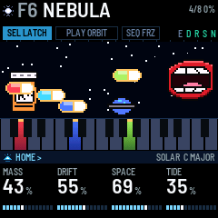
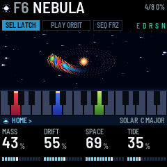
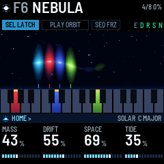
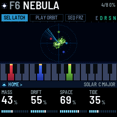

# DEEP FIELD

DEEP FIELD turns the M-VAVE FM-1 into an ambient drone machine. Each key you press starts a *body*: one voice that
swells in, keeps sounding, slowly breathes and drifts, and fades out when you stop it. Up to eight bodies play at
once.

- The four knobs on the HOME page shape every body at the same time.
- Hold a body's key and the knobs set that body alone: its level, tone, tuning, and whether ORBIT may move it.
- ORBIT moves the bodies to nearby notes on its own, or runs an arpeggio over them.
- Ten models, from eight breathing harmonics to wavetables and four-operator FM.
- The reverb can freeze and shimmer.
- A scene is a sound: change scene and your chord keeps playing while the sound morphs under it.
- MIDI comes in over USB, Bluetooth and the TRS jack, and goes out over USB and Bluetooth.

---

## Contents

1. Install
2. The first minute
3. The screen and the lights
4. The keys: bodies, LATCH, the scale
5. The four forces (HOME)
6. The pages
7. ORBIT
8. FREEZE and the effects
9. Scenes: changing, saving, blending
10. The views
11. MIDI and Bluetooth
12. The screen reader
13. Troubleshooting

---

## 1. Install

**From the browser:** open the installer page in Chrome or Edge and connect the FM-1 by USB. The installer can
also put M-VAVE's own firmware back.

**From a terminal:** download the firmware file (deepfield-X.Y.fwsc, where X.Y is the version) from the site,
connect the FM-1 by USB, and run `python3 base/tools/fm1_install.py deepfield-X.Y.fwsc` in a copy of DEEP FIELD's
source code (github.com/WisestWizard/deepfield).

If an install asks for update mode, hold REC while you switch the FM-1 on.

Installing is at your own risk. If the FM-1 only shows up as a disk called `WL82 UBOOT1.00`, the rescue tool
`fm1_rescue` (from felucca-bsp) recovers it.

---

## 2. The first minute

Some of the FM-1's buttons do something other than their printed name: SEL is LATCH, PLAY runs ORBIT, SEQ is
FREEZE, REC is Bluetooth, and ARP opens ORBIT's page (it doesn't start an arpeggio by itself). SEL is a button and
SELECT is a knob: they are different controls.

1. Switch on. The scene F1 FIRST LIGHT loads in silence: nothing plays until you press a key. SEL is lit, which
   means LATCH is on: each key you press keeps sounding.
2. Press a few keys, one at a time. Each one swells in and stays, shown on the screen as a beam over its key. Its
   key lights up and its beam rises.
3. Tap one of those keys again. That body fades out as you let go, and its beam sinks. (Hold it instead and the
   knobs set that body alone: section 4.)
4. Turn KNOB 1 (MASS): every body gets brighter or darker. Turn KNOB 3 (SPACE): they sink further into the
   reverb. The four boxes along the bottom of the screen are the four knobs.
5. Press PLAY. ORBIT starts and PLAY lights green. Every few seconds one body slides to a nearby note in the
   scale: watch its beam move.
6. Press SEQ. FREEZE turns on (FRZ lights): the reverb holds what it has. Press SEQ again to let it go.
7. Turn PRESETS. The scene names scroll past with a line filling under them. Stop, and when the line is full the
   scene's sound blends in over four seconds, under the chord you are playing. Hold SEL while you turn PRESETS to
   bring in the scene's own chord as well (section 9).
8. Hold SEL for a second: every body stops. Then tap SEL: LATCH turns off, and a key now sounds only while you
   hold it.

---

## 3. The screen and the lights

The screen is laid out like the panel. The strip of keys on the screen matches your keys, and the four boxes at
the bottom match the four knobs. Only sound gives off light: the bodies glow, and everything around them stays
dark. Each colour has one meaning:

| Colour | Means |
| --- | --- |
| A body's own colour | That body (by its note): its beam, its key on the strip, its band when open |
| Sun (warm gold) | Latched: a spark over the beam, a cap on the key, a bar under a pinned body |
| White | Your hand: a lead, the body you have open |
| Cyan | Where you are: the page band, the bars, the morph line |
| Teal | An effect that is on |
| Orange | Something to look at: unsaved changes, LOAD, a failed save |

**Key lights** have three levels:

- **Bright:** what you are playing. A latched body's key, or a lead's key while you hold it (a lead is a note
  played with LATCH off: section 4).
- **Half:** what the machine is doing. A body fading out; the key a body started on before ORBIT moved it; the
  latched bodies' keys while LATCH is off; a lead fading out; the lowest or highest key, standing in for a body
  whose note is off the keyboard; and the key ORBIT will move a body to next, which blinks just before the move.
- **Glow:** a note in the scale. With the scale set to CHROMA, nothing glows.

To stop a body, tap the key it started on. After ORBIT has moved a body, that is its half-lit key, not the bright
one: pressing the bright key starts a second body there. A body's key you hold blinks for a third of a second, then
its body opens (section 4).

A lead's key blinks off for an instant each time it is struck, so you can see every step of an arpeggio, or an
accent on a key that is already lit. While FX is held, the keys show the effect switches instead (section 8).

**Button lights:**

- The open page's button is lit (half-lit while FX is held).
- SEL is lit while LATCH is on, SEQ while FREEZE is on.
- SAVE is lit while the sound or a setting has changed since the last save, and blinks in the save dialog.
- PLAY shows ORBIT's mode by its colour: green for WANDER, red for ARP, and orange (green and red together) for the
  others. It blinks at each SCATTER move and each ARP step.
- OCT- or OCT+ is half-lit one octave from the middle, fully lit two octaves from it.
- A button you hold blinks after a third of a second until its hold takes effect (SEL stops every body, PLAY opens
  the ORBIT page, REC switches Bluetooth), so you can see it counting.

| Part | What it shows |
| --- | --- |
| Header | The model's glyph, then the scene's slot (F1–F16, U1–U16) and name, with a small orange square after it while it has unsaved changes. On the right: OCT when the octave isn't zero; USB while a computer records (USB MUTE when the speaker is silenced, section 11); BLE when a computer, phone or tablet is connected over Bluetooth; DEV when the FM-1 is connected to a Bluetooth MIDI keyboard or controller; how many bodies are sounding; and how busy the processor is (LOAD in orange: see Troubleshooting). Below that, three pills named for their buttons, SEL LATCH, PLAY ORBIT and SEQ FRZ, filled while on, always in the same places (while ORBIT runs, a white line fills along the foot of its pill toward the next move); the letters E D R S N, lit for the effects that are on (ensemble, delay, reverb, shimmer, noise); and a cyan line along the bottom edge while a scene blends in. |
| The view | The bodies: as beams over their keys, or in one of the other views (section 10). Turning a knob shows its name, its value large and its bar here for a moment; the beams dim but stay in view behind it. Messages such as LATCH OFF, ORBIT ON or SAVED appear here too, and so does the list of scenes while PRESETS turns (section 9). While FX is held, the five effect switches are shown here in a row. |
| The keys strip | All 27 keys as dark glass, lit only by sound: a sounding body's key glows in its colour, bright at the top and dimming down the key (dim while it fades), with a sun cap when latched; the keys of the scale are slightly lighter glass; a lead's key is white (grey as it fades); the key ORBIT will move a body to, and the key a moved body started on, show in the body's dim colour; the body you have open is framed white. |
| Footer | The page band: the icon of the button that opened the page, its name, the page's name, and `<` `>` where SELECT can go, with the model, the scale and its root on the right. Below it, the four knobs in the order of the real knobs: each name, its value (a number large with its unit small, or a word), and a bar that shows the kind of value: segments filling for an amount, one cell per choice for a list, two cells for an on/off switch, hits and rests for RHYTHM. On DX the SHAPE knob reads VOICE, on SCAN TABLE. While a body is open, the band reads BODY and its note in the body's colour, and the four knobs are its own (section 4). |

---

## 4. The keys: bodies, LATCH, the scale

A **body** is one voice, and up to eight sound at once. A key starts a body at its note, and the body swells in
over SWELL seconds (ENVELOPE page). Leaning on a key, pressing harder once it is down, makes its body brighter and
adds wobble for as long as you lean; PRESS (ENVELOPE page) sets how much. The top seven keys (C#5 to G5) can't sense
a lean.

With **VELOCITY** off (the default, on the MIDI page), every key starts its body at the same level, so chords are
even. With it on, how hard you strike a key sets its body's level. MIDI notes always use their own velocity.

If you start a ninth body, one fades out quickly to make room: a body that is already fading if there is one, or
else the oldest.

**LATCH** (SEL, lit while on; on by default): a body keeps sounding after you let go of its key. Tap the same key
again to stop it: it fades out over FADE seconds from when you let go. A latched key has a sun cap on the screen's
keys strip, and its beam a sun spark over its head. Hold SEL for a second to stop every body (the screen says EVERY BODY LET GO). Bringing in a
scene's chord (section 9) latches its bodies and turns LATCH on.

**A body's own values.** With LATCH on, each latched body can be set apart from the others:

1. Hold the key the body started on (after an ORBIT move, its half-lit key). The key blinks.
2. After a third of a second the body opens: the footer reads BODY and its note, its beam and its key get a white
   frame, and the other beams dim. (Turning a knob while the key is down opens it at once.)
3. The four knobs are now that body's own:
   - **LEVEL**: -24 to +6 dB, one dB a click, and MUTE below -24. A muted body stays latched and silent, so ARP and
     ORBIT still use its note.
   - **TONE**: the body's own MASS, -50% to +50%: a dark root under a bright top.
   - **TUNE**: -50 to +50 cents, a cent a click. A few cents on a fifth makes it beat slowly; -14 cents on a major
     third makes it pure.
   - **ORBIT**: turn right for PINNED, left for MOVES. ORBIT never moves a pinned body, PULSE never dips it, and ARP
     leaves it out, so CHORD and CYCLE move the rest of the chord over it like a pedal note. TRANSPOSE still moves
     it. A sun bar across the foot of its beam marks it.
4. Let go of the key. The footer goes back to the page you were on, and the body keeps its values (and keeps
   sounding: once a body is open, letting go never stops it). SAVE lights.

Hold several latched keys and the knobs move all of those bodies together, each from where it is. The values travel
with the body when ORBIT or TRANSPOSE moves it, and are saved with the scene. Over MIDI they go out as NRPN (section
11), so a computer can record them.

**Playing leads over the bed.** Tap SEL to turn LATCH off (the screen says LATCH OFF, KEYS PLAY). The bodies that
were latched keep sounding: that is the *bed*. The keys now play **leads** over it. A lead is a note in the scene's
own sound that plays while you hold its key and fades when you let go. Leads never latch, and ORBIT never moves
them. A key whose note is already latched plays a lead on top of its body, as an accent. Up to four leads play at
once; a fifth replaces the oldest. On the screen a lead is a thin white beam, and its key is white on the keys
strip. Tap SEL again to go back to LATCH.

MIDI notes work the same way: with LATCH on, a MIDI note plays a body that sounds until its note off (it never
latches); with LATCH off, it plays a lead.

The LEAD page (ENV, then SELECT) shapes the leads: ATTACK (1 ms to 2 s), RELEASE (30 ms to 7.7 s), LIFT (up to two
octaves higher, in semitones) and LEVEL (59% matches a body; 100% is 6 dB louder).

**Transposing the bed.** With some bodies latched, hold SEL and touch a key within a second (held longer, SEL stops
every body). The pill reads SEL TRANS, and the keys stop starting bodies. Each key you play now moves the whole
latched chord: its lowest note goes to that key, and the other notes keep their distance above it. The screen says
TRANSPOSE and the note. The bodies glide there over GLIDE (ENVELOPE page), and the keys they started on move with
them. Letting go of the key leaves the chord where it is. Over MIDI, the old notes are switched off and the new ones
on. Tap SEL to go back to LATCH, or hold SEL for a second to stop every body, which also ends TRANSPOSE.

**The scale.** SCALE on the GLOBAL page picks the scale: CHROMA, MAJOR, MINOR, DORIAN, PHRYGIA, LYDIAN, MIXO,
PENTA+ (major pentatonic), PENTA- (minor pentatonic), WHOLE or HARM- (harmonic minor). ROOT picks its root note.
Every key, black keys included, always plays its own note. The scale does two things: its notes glow on the keys,
and ORBIT only moves bodies to notes in it.

**OCT- and OCT+** move the keys down or up an octave, up to two octaves each way. The header shows OCT and the
number.

---

## 5. The four forces (HOME)

HOME is the main page. Its four knobs, MASS, DRIFT, SPACE and TIDE, are the four forces: each one shapes every body
at once.

| Knob | Name | What it does |
| --- | --- | --- |
| KNOB 1 | MASS | How full and bright the sound is. What it changes depends on the model: on SOLAR, how many harmonics and how bright; on VOID, the filter cutoff (shown in Hz); on GLASS and DX, the FM depth; on STRING, the string's brightness; on SCAN, a filter that follows the note. Leaning on a key adds to it for that body, and so does the body's own TONE. |
| KNOB 2 | DRIFT | How much everything wanders: the detuning, the slow drift of pitch, the wobble, the breathing of the harmonics, and how fast the stars move on the screen. |
| KNOB 3 | SPACE | How much reverb, and a little delay. The dry sound stays as it is. |
| KNOB 4 | TIDE | How much each body fades down and back up on its own slow cycle. At full, each body goes all the way to silence and back. TIDE RATE (MOTION page) sets how fast. |

MASTER is the volume.

---

## 6. The pages

Each button opens its page, and the four knobs then set that page's four values, shown along the bottom of the
screen. A button always opens the same page, and its light shows which page is open. Turn SELECT to step to the
next or previous page, in the order of the table below: DELAY, DELAY 2 and REVERB are one, two and three steps
after ENSEMBLE, for example. The page band's `<` and `>` show where SELECT can go. A page stays open until you
press another page button or turn SELECT. Most values show on the screen as a percentage.

**Turning the knobs.** Turned slowly, a knob moves in small steps: about 43 clicks from one end to the other. Turned
quickly, in big ones: 16 clicks end to end. VOID's MASS, a free DLY TIME and ATTACK move in finer steps still, and
RATE one BPM a click. A knob with only a few values (STEPS UP TO, DISTANCE, BODIES, LIFT, the delay's note lengths,
DX's voices) moves one value a click at any speed.

COLOUR is on both NOISE and DELAY 2, and WIDTH on both MOTION and NOISE 2: the page band tells you which one you are
turning.

| Button | Page | KNOB 1 | KNOB 2 | KNOB 3 | KNOB 4 |
| --- | --- | --- | --- | --- | --- |
| HOME | HOME | MASS | DRIFT | SPACE | TIDE |
| EDIT | BODY | MODEL (also on ALGORITHM) | SHAPE | SUB | AIR |
| EDIT, SELECT once | NOISE | LEVEL (0 is off) | COLOUR (brown to white) | WIND (how fast it moves, how often it gusts) | BAND (wide, narrow, or on the bodies: see below) |
| EDIT, SELECT twice | NOISE 2 | TEXTURE (hiss, rain, crackle) | GUST (how far it swells and drops) | DUCK (how far it backs off under a chord) | WIDTH |
| ENV | ENVELOPE | SWELL (fade-in, 30 ms to 20 s) | FADE (fade-out, 30 ms to 20 s) | PRESS (how much a lean brightens) | GLIDE (how long an ORBIT move or a transpose takes) |
| ENV, SELECT once | LEAD | ATTACK (1 ms to 2 s) | RELEASE (30 ms to 7.7 s) | LIFT (0 to +2 octaves, in semitones) | LEVEL |
| LFO | MOTION | TIDE RATE | WOBBLE (vibrato) | WALK (a slow random drift of pitch) | WIDTH (stereo spread across the notes) |
| LFO, SELECT once | MOTION 2 | SPREAD | CROSS | TIMBRE | SWAY |
| FX | ENSEMBLE | ENSEMBLE (OFF, CHOR I, CHOR II or ENSEMBLE, the fullest) | ENS MIX | – | – |
| FX, SELECT once | DELAY | TYPE (PING, TAPE, HEADS, REVERSE, RISE, FALL, GRAINS) | DLY TIME | DLY FDBK (how many repeats) | DLY MIX (how loud) |
| FX, SELECT twice | DELAY 2 | COLOUR (dark or bright repeats) | DIFFUSE (echoes blurred into a cloud) | WOW (how far the tape wanders) | CHOP (only slices of the sound go in) |
| FX, SELECT three times | REVERB | REV SIZE (how long it rings, about 0.6 to 8 s) | REV DAMP (how fast the highs die away) | SHIMMER | SPACE (the same as on HOME) |
| ARP, or hold PLAY | ORBIT | MODE | Depends on the mode (section 7) | Depends on the mode | Depends on the mode |
| ARP, SELECT once | ORBIT 2 | HOME PULL | OCTAVES (ARP, 1 to 3) | RHYTHM (ARP: its hits and rests) | DIV (ARP: a step's length) |
| GLO | GLOBAL | SCALE | ROOT | VIEW | MORPH (NOW, or 1 to 30 s) |
| GLO, SELECT once | MIDI | IN CH (OMNI or 1–16) | OUT CH (1–16) | LOCAL | VELOCITY |
| GLO, SELECT twice | USB | SPEAKER (ON, AUTO, OFF) | USB LEVEL (the recording's level, 0 to -18 dB) | CLOCK OUT | – |

**The models** (turn ALGORITHM, or KNOB 1 on BODY). Turning ALGORITHM restarts the bodies in the new model with a
short fade; a scene in another model crosses them over instead (section 9).

| Model | What it is | MASS | SHAPE |
| --- | --- | --- | --- |
| SOLAR | Eight harmonics, each breathing on its own | More harmonics, brighter | Odd harmonics (hollow), then all of them, then even ones (like an organ) |
| VOID | Three detuned saws and a sub through a dark filter | The filter cutoff | The detune |
| GLASS | Two-operator FM with a breathing depth and a detuned second carrier | The FM depth | The ratio: 1, 2, 3, 3.5, 4, 5, 7 or 1.41 |
| STRING | A bowed string | Brightness | No effect |
| CHOIR | A buzz through three vowel formants | Moves the formants up and brings the upper two forward | The vowel: A, E, I, O, U |
| BELL | Four partials, each breathing on its own | Brighter upper partials | From the harmonic series to a bell's ratios |
| SHEPARD | Six octaves of sine under a moving window: a rise or fall that never ends | Leans the window high or low | Still at the middle; below it falls, above it rises, faster further from the middle |
| FOLD | A sine through a wavefolder (DRIFT makes the fold breathe) | The filter after the fold | How hard it folds |
| SCAN | Pocket Poly's three wavetables in one sweep: ANALOG (sine to saw, square and a narrow pulse), VOX (vowels), GLASS (a bright cluster that climbs). DRIFT lets each body's place wander. | A filter that follows the note; the level stays the same | Where in the sweep: the screen names the table and its frame (ANALOG 1 to GLASS 16) |
| DX | Four-operator FM after Pocket Poly's FM engine. Its envelopes run at SWELL's pace, so a slow SWELL evolves the timbre slowly. DRIFT breathes the brightness. | The FM depth | The voice, one a click: GLASS PAD, BRASS, ORGAN, BELL PAD, E.PIANO, WOOD, STRINGS, CLUSTER |

SUB adds an octave below on every model. AIR adds breath or noise: the bow's noise on STRING, breath on CHOIR, the
hiss of the strike on BELL, a breath of noise on SHEPARD, and noise into the fold on FOLD. On SCAN it adds a second,
detuned copy from another place in the sweep; on DX, feedback (grit). It does nothing on SOLAR, VOID or GLASS.

**The noise layer** (EDIT, then SELECT for NOISE, and once more for NOISE 2) is a stereo noise under the bodies,
or on its own with no keys held: wind, sea, rain or breath.

- **LEVEL** turns it on and sets how loud it is (0 is off).
- **COLOUR** runs from brown (a deep rumble, down to 25 Hz) to white.
- **WIND** sets how fast the noise moves and how often a gust comes.
- **BAND**: at 0, a wide bed. Up to the middle, a band that narrows onto the newest note. Past the middle, narrow
  bands on the four loudest bodies, each as loud as its body, so the noise becomes air through the chord.
- **TEXTURE**: hiss, then rain (dense drops), then crackle (sparse, dusty ticks), all at the same loudness. The
  screen names the one you are in.
- **GUST**: now and then (at WIND's pace, from every few seconds to every half minute) the noise swells louder,
  brighter and higher over a second or three, then dies back over several. Between gusts it sits lower, by up to
  18 dB as GUST goes up. The noise always comes in with a gust, and FREEZE holds the weather where it is.
- **DUCK** backs the noise off under a chord, by up to 12 dB, so it fills the gaps instead of covering the bodies.
- **WIDTH** is its stereo width.

The four forces shape the noise too: MASS brightens it, DRIFT widens its wander, SPACE sends it to the reverb, and
TIDE makes it breathe. Leaning on a key brightens it, and it fades in and out at SWELL and FADE like a body. Hold
FX and press C4 (white key 5) to switch it off and on again. Switched back on, it returns at the level it had when
you last switched it off, or else at the scene's saved level, or else at a third. N lights in the header while it is
on, and its beam on the screen rises with each gust. MIDI CC 20 sets its LEVEL.

**MOTION 2** (LFO, then SELECT) makes the eight bodies sound like eight separate voices instead of one sound at
eight pitches.

- **SPREAD** gives each body its own small differences for as long as it sounds: up to 14 cents of detune, a
  little more or less MASS, its own breathing speed and its own place in the stereo field.
- **CROSS** links the bodies in fixed pairs: as one swells, it bends the other's pitch.
- **TIMBRE** lets each body's MASS wander slowly on its own, so the chord's colour shifts unevenly.
- **SWAY** moves each body across the stereo field on its own slow cycle, from one swing every 50 s to one every
  3 s.

**The delay.** DLY FDBK sets how many repeats and DLY MIX how loud they are. **TYPE** (the first knob on DELAY)
chooses what kind of delay it is:

| TYPE | What you hear |
|---|---|
| PING | Left, then right, then left again, each repeat a little further away. The right-hand echo comes a little later than the left one, so the repeats never fall into a pattern. |
| TAPE | One echo in the middle, darker and grittier each time round, its pitch wandering, so it beats against the drone. |
| HEADS | Three echoes for every one: at a third, two thirds and the whole of DLY TIME, left, centre and right. One note becomes a rhythm. |
| REVERSE | Each echo plays backwards: a note's echo swells up to where it started. |
| RISE | Each echo an octave higher than the last, climbing out of the drone and thinning as it goes. |
| FALL | Each echo an octave lower, sinking under the drone. |
| GRAINS | Short pieces of the last two seconds, one every DLY TIME, scattered left and right: a held chord turns into a glittering cloud of itself. |

Turning TYPE fades the echoes out and starts the new kind fresh.

A held drone hides its own echoes: an echo of a steady sound is the same steady sound. TAPE's wander, RISE and FALL's
pitch, REVERSE's swell and GRAINS' pieces make them heard; on PING, and on all of them, CHOP and WOW help.

- Over most of its turn, **DLY TIME** is a time from 50 to 800 ms, and the screen shows it in ms. On PING the
  right-hand echo comes a little later than the left one, up to 1.1 s.
- Near the top of its turn, DLY TIME becomes a note length: 1/16, 1/8, 1/4T, 1/8D, 1/4, 1/4D or 1/2 (T is a
  triplet, D is dotted). The tempo comes from RATE (ARP's tempo, on the ORBIT page with MODE set to ARP), or from
  MIDI clock when it is coming in, so the echoes land in time with ARP; on PING the right-hand echo then lands on the
  beat too. A length that would be longer than 800 ms at that tempo plays at half length, still in time. On GRAINS,
  DLY TIME is how often a piece comes.
- **COLOUR** (DELAY 2) filters the repeats: low, they get darker and stay full; high, they get thinner and
  brighter, so they stand apart from the drone.
- **DIFFUSE** (DELAY 2) blurs each repeat: at 0 a clean tape echo, past the middle a short burst, at full a cloud
  that trails the drone instead of repeating it.
- **WOW** (DELAY 2) sets how far the tape's pitch wanders: at 0 clean, at about a third the gentle wander the delay
  always had, at full seasick. A wandering echo goes slightly out of tune with the drone, and you hear it beat.
- **CHOP** (DELAY 2) lets only slices of the sound into the delay, one at the start of every DLY TIME: at 0
  everything goes in, at full a short slice. A held chord then comes back as a pulse of itself, in time with the
  delay. The slices are made louder as they get shorter, so the echoes stay as loud overall.
- Changing DLY TIME bends the pitch on its way, like tape.

---

## 7. ORBIT

ORBIT moves the latched bodies by itself. Press PLAY to start it and again to stop it; when it stops, the bodies
stay where they are. When it starts, the screen names the mode (WANDER EVERY 5.1S, for example). While it runs, the
PLAY pill fills up toward the next move and flashes when it comes. The pill is named for the mode: PLAY ORBIT for
WANDER, PLAY CHORD, PLAY SCATTER and so on.

Pick the mode with KNOB 1 (MODE) on the ORBIT page: press ARP, or hold PLAY. KNOB 2 to KNOB 4 change with the mode,
and PLAY's colour shows it:

| Mode | PLAY | KNOB 2, 3, 4 | What happens |
| --- | --- | --- | --- |
| WANDER | green | EVERY, CHANCE, STEPS UP TO | Every EVERY seconds (give or take a quarter), with a CHANCE, one body moves to a nearby note in the scale, up to STEPS UP TO scale steps away. It never moves onto a note another body is playing. |
| CHORD | orange | EVERY, CHANCE, DISTANCE | All the bodies move together by the same number of scale steps, up to DISTANCE, so the whole chord shifts to a related one. |
| SCATTER | orange | EVERY, BODIES, STEPS UP TO | Several bodies move at once, each its own way, with looser timing (give or take a half). BODIES sets how many: one at 0, all the latched bodies at full. |
| ARP | red | RATE, GATE, ORDER | An arpeggio. The bodies keep droning while a lead (section 4) steps through their notes. RATE is the tempo (40 to 240 BPM) and DIV (ORBIT 2) how long a step is (an eighth note unless you change it). GATE is how long each step is held (smoothly joined at the top). ORDER is UP (from the lowest), DOWN (from the highest), UP DOWN, RANDOM, or PLAYED (the order you struck them). OCTAVES (ORBIT 2) spreads it over more octaves, and RHYTHM (ORBIT 2) puts rests between the notes. Add or let go a body while it runs and it carries on from the note it just played. ARP remembers the notes, in the same ORDER: stop every body (hold SEL) and it keeps playing until you press PLAY. A pinned body is left out: it drones under the runner. The pill fills over the RHYTHM's steps. |
| CYCLE | orange | EVERY, CHANCE, CHORDS | The chord walks through a progression, picked with CHORDS (below). Each step is counted in scale degrees from where you played the chord. |
| ECHO | orange | EVERY, DECAY, JUMPS | Your last eight leads (keys played with LATCH off, or MIDI notes then) come back as a phrase every EVERY seconds, quieter each time, losing notes (DECAY) and jumping octaves (JUMPS) until it is gone. A new note starts it again with the new phrase. ARP's own notes don't count. |
| PULSE | orange | EVERY, CHANCE, ROLL | Every EVERY seconds, with a CHANCE, each body dips and swells back at SWELL speed, from low to high, ROLL apart: a slow strum across the chord. |

Every mode but ARP needs at least one latched body: with none, nothing moves (so ECHO needs a bed under the leads).
SCATTER and ECHO have no CHANCE knob, but they still use the CHANCE last set in another mode. A pinned body (section
4) is never moved.

**EVERY** runs from 0.1 s to 60 s, shown in tenths of a second below ten. Under a second ORBIT stops changing the
chord and starts playing it: at half a second WANDER and SCATTER make a slow melody inside the chord, and with GLIDE
longer than EVERY the bodies never land, a swarm. CHORD that fast is mostly a blur. Under half a second the screen
stops showing where the moves go (they would only flicker). ECHO never runs faster than once a second: its phrase
needs the time.

**RHYTHM** (ORBIT 2, for ARP) spreads the notes over a pattern of steps as evenly as they go, and rests on the
others: 8/8 (every step a note), 5/8, 3/8, 7/12, 5/12, 4/9, 7/16 or 5/16. The notes move on only at a note, so four
notes over five hits fall differently against the pattern every time round. **DIV** sets a step's length against
RATE's beat: 1/16, 1/16T, 1/8, 1/8T, 1/8D, 1/4, 1/4T, 1/2 or 1 BAR (T a triplet, D dotted). Slow steps with a long
RELEASE (LEAD page) toll like bells.

CYCLE's progressions: I IV V, I VI IV V, I V VI IV, I VI III VII, I IV I V, I II V, I III VI IV and I VII IV. They
are scale degrees, so in a minor key I IV V means i iv v.

**HOME PULL** (ORBIT 2) is the chance that a body, or in CHORD the whole chord, is pulled back to the key where it
started. ORBIT leaves alone the bodies held over MIDI, the pinned bodies, and the leads. Each move goes out over MIDI as a note off and
a note on.

**Seeing where it goes.** ORBIT picks each move when the countdown starts, so you can see it coming. A line grows
from the top of the body's beam toward the key it is going to, and a faint ghost beam stands at that key. On the
panel the key is half-lit and blinks just before the move; on the screen's keys strip it shows in the body's dim
colour. When the move comes, the beam slides along the line and the key light follows it, while the starting key
stays half-lit. On the ORBITS view, a planet's orbit grows or shrinks as it glides to the new pitch.

**MIDI clock.** While MIDI clock comes in (over USB, TRS or Bluetooth), ARP steps at DIV of it and RATE reads EXT;
EVERY counts in whole beats of that tempo (or a half or a quarter of a beat, below one), so ORBIT's moves land in
time. A MIDI start restarts ARP.
After two seconds without clock, ORBIT goes back to its own timing. CLOCK OUT (USB page) sends clock, with start
and stop, while ARP runs from RATE, so a drum machine can follow the FM-1.

---

## 8. FREEZE and the effects

**FREEZE** (SEQ, lit while on): the reverb holds what it has, forever. Nothing new goes in, nothing dies away, and
it comes up to about the level of the dry sound. The bodies keep playing on top, dry and through the delay. The
shimmer is silent while frozen. Press SEQ again to let it go. While it is frozen, four ice brackets stand in the
view's corners and the view holds still: the stars stop drifting and twinkling, the beams stop breathing, the mist
stops moving.

**SHIMMER** (REVERB page) feeds the reverb back into itself an octave higher: a rising cloud. It can't run away,
whatever the reverb's size.

**Switching effects on and off.** Hold FX, and the five lowest white keys become switches, on every scene:

| Key | Switches |
| --- | --- |
| F3 (white key 1) | Ensemble |
| G3 (white key 2) | Delay |
| A3 (white key 3) | Reverb |
| B3 (white key 4) | Shimmer |
| C4 (white key 5) | The noise layer |

Press a key to switch its effect on, and again to switch it off. Switched off, the delay and the reverb stop
taking in sound and let what they hold ring out, as a pedal's spillover does (a frozen reverb stops at once). An
effect the scene has at zero comes in at a useful amount: DLY MIX 27%, SPACE 35%, SHIMMER 23% (with the reverb), and ENSEMBLE CHOR I with ENS MIX at 31%. While
FX is held, the screen shows the five switches in a row, each ON or OFF (the noise with its level), and the keys of
the effects that are on light teal. The keys play no notes while FX is held. The switches are saved with the scene,
and E D R S N in the header show which effects are on.

Tap FX without pressing a key to open the effects pages instead: ENSEMBLE, then turn SELECT for DELAY, DELAY 2 and
REVERB, in the same order as the keys.

---

## 9. Scenes: changing, saving, blending

A scene is a sound. It holds the values on the sound pages (HOME, BODY, NOISE, ENVELOPE, LEAD, MOTION, the effects
and ORBIT) and the effect switches. It also keeps a chord: the bodies that were latched when it was saved, with
their own values (section 4). The GLOBAL, MIDI and USB pages are settings instead: they stay as they are when you
change scene. F1–F16 are the factory scenes. U1–U16 are yours, and start with no chord.

**Changing scene.** Turn PRESETS. The view shows the scene you are turning to large, its neighbours on either side,
and all 32 slots as a row of marks (F1–F16, then U1–U16): the one you are on in cyan, the one you are turning to
tall and white. Nothing changes while you keep turning. A line fills along the foot of the view, and when it is
full (0.7 s after you stop) the scene lands, and its sound
blends in over MORPH seconds (GLOBAL page; 4 s by default, or NOW to switch at once). A bar along the bottom of the
header shows the blend.

- Your chord keeps sounding. If the new scene has another model, each body crosses into it, the new sound rising as
  the old one fades. With eight bodies there is no room to cross, so they switch one at a time, low to high, and
  the chord never drops out at once.
- LATCH, ORBIT (PLAY, its colour, and while it runs its page's values too), FREEZE, the octave and the scale stay as
  they are.
- A delay or reverb the new scene switches off rings out.
- A MIDI program change does the same.

**Bringing in a scene's chord.** Hold SEL and turn PRESETS: the screen says SCENE + CHORD (in the scene list,
+ CHORD in sun under the name). Let go of SEL and the
whole scene lands: its chord replaces yours (a note in both keeps sounding), LATCH turns on, and its ORBIT values
come too. To bring in the chord of the scene you are on, turn PRESETS one click forward and back before you let go.
A scene with no chord leaves your bodies alone. Every factory chord is stored on C and plays in ROOT (GLOBAL page);
a chord you save plays in the ROOT it was saved in, moved to today's.

**Switching on.** The scene you were on loads in silence: its sound is ready, and nothing plays until you press a
key (or bring in its chord).

**Saving.**

1. Press SAVE. The screen says SAVE SCENE TO and a user slot.
2. Turn PRESETS (or SELECT, or KNOB 1) to choose U1–U16.
3. Press SAVE again. The sound and the bodies latched right now (each with its own values, in the ROOT you are
   in) go into that slot, and the screen says SAVED. Press HOME instead to cancel.

The saved scene takes the name of the scene you were playing, unless you save over the user slot you are on, which
keeps its name.

Every save also stores the settings: which scene you are on, the octave, scale, root, LATCH, VELOCITY, LOCAL, the
view, MORPH, the MIDI channels, the USB page, and Bluetooth on or off. Nothing is stored until you save: switch off
without saving and all of it goes back to the last save.

**Blending by hand.** Hold GLO and lean on a key: the harder you press, the further the sound blends toward the
next scene (the slot after this one). The header's bar and the screen show which scene and how far. The lean is
counted from where the key settles, so press the key, wait a moment, then push. The top seven keys (C#5 to G5)
can't sense a lean: hold one under GLO and the blend climbs to full over two seconds. Let go of the key and the
blend stays where it is, between the two scenes, until the next scene loads. The keys play no notes while GLO is
held, and only the values blend: the bodies and the model stay as they are.

**The factory scenes** (their chords stand on C, in ROOT):

| Scene | Model | Sound |
| --- | --- | --- |
| F1 FIRST LIGHT | SOLAR | A warm major chord |
| F2 VOID TIDE | VOID | Low and breathing |
| F3 GLASS ORBIT | GLASS | Shimmer and delay; made for ORBIT |
| F4 BOWED SKY | STRING | Wide |
| F5 PULSAR | GLASS | A fast tide |
| F6 NEBULA | SOLAR | Hollow, very slow swells, drowned in reverb, a wind bed |
| F7 DEEP VOID | VOID | Sub and a long delay over a quiet crackle |
| F8 STARLIGHT | STRING | Bright, airy, high |
| F9 CATHEDRAL | CHOIR | An open vowel in a big hall |
| F10 LOW CHOIR | CHOIR | A closed vowel, low, with sub and breath on the voices |
| F11 GAMELAN | BELL | Bell ratios and shimmer; made for ORBIT |
| F12 ICE BELLS | BELL | High and wide, with a bright rain |
| F13 ASCENT | SHEPARD | Rising |
| F14 DESCENT | SHEPARD | Falling, dark, a low wind |
| F15 FOLDED SUN | FOLD | Bright, with ensemble |
| F16 TIDE POOL | FOLD | Dark, a deep tide, delay |

---

## 10. The views

VIEW on the GLOBAL page picks how the screen draws the bodies. BEAMS is the one to play by; the others are
different pictures over the same keys.

| View | What you see |
| --- | --- |
| BEAMS | Each body is a beam of light rising from its key, in its key's colour, brightest at its foot, with a white-hot head that marks its level: you see it swell in and sink as it fades (dim), and it breathes with the body. A latched beam has a sun spark over its head; a pinned one a sun bar across its foot; an open one (section 4) white frames, with the other beams dimmed. An ARP step flashes its body's head. When ORBIT moves a body, its beam slides to the new key and leaves a mark where it started, and before the move a line reaches from its head toward a dotted ghost at the key it is going to. A body above or below the keys (a MIDI note, or after an octave change) stands thin at the edge. The noise layer is a mound of mist where its band sits, warm when brown and pale when white, drifting with WIND and lifting with each gust. Stars drift at DRIFT's speed, each twinkling slowly on its own, over a faint horizon; FREEZE stills all of it and puts ice brackets in the corners. |
| MOUTH | An orange pill bottle on the left pops its cap and tumbles out a pill for every new body. A mouth on the right opens with the sound. The pills hang over their keys, high notes higher, in two colours (the body's and white), outlined in sun once latched. A body you stop flies into the mouth and is eaten. Now and then the mouth snatches the pill of a body that is still sounding and spits it back out. |
| ORBITS | A sun that pulses with the sound. Each body is a planet: its distance from the sun is its pitch, its speed follows its breathing, its size is its level, and its colour is its note. A latched planet has a sun ring; a fading one dims. Stars drift behind at DRIFT's speed. |
| NEBULA | The bodies' harmonics as glows along a wavy band, low notes on the left and high on the right, coloured by body, with a mark under each body's note. |
| SCOPE | A radar. Each body is a blip: its note sets the angle and its octave the distance from the centre, and it lights as the sweep passes. The sound's left channel against its right draws a figure; its shape shows the stereo width and the beating. |

Every view except MOUTH leaves fading trails as things move.

---

## 11. MIDI and Bluetooth

**MIDI in** comes over USB, Bluetooth and the TRS jack, on IN CH (OMNI, any channel, by default). With LATCH on, a
MIDI note plays a body until its note off; with LATCH off, it plays a lead (section 4). The sustain pedal (CC 64)
keeps the bodies going. Poly and channel pressure brighten the sound, like leaning on a key. Pitch bend bends
everything up to two semitones either way. MIDI clock times ORBIT (section 7).

**MIDI out** goes over USB and Bluetooth, on OUT CH. The TRS jack is in only. A key sends a note on when you press
it, and a note off when its body starts to fade, which is later than your release if the body was latched. Leaning
on a key sends poly pressure. ORBIT's moves go out too. With LOCAL off (MIDI page), the keys only send MIDI and
don't play DEEP FIELD.

| MIDI CC | What it does |
| --- | --- |
| 1 | Wobble (the mod wheel) |
| 7 | Volume |
| 16, 17, 18, 19 | MASS, DRIFT, SPACE, TIDE |
| 20 | The noise layer's LEVEL |
| 64 | Sustain |
| 71 | SHAPE |
| 72 | FADE |
| 73 | SWELL |
| 74 | MASS |
| 91 | SPACE |
| 93 | ENS MIX |
| 94 | DLY MIX |
| 102 | The delay's TYPE (0–127 in seven equal parts: PING, TAPE, HEADS, REVERSE, RISE, FALL, GRAINS) |
| 103 | WOW |
| 104 | CHOP |
| 120 | Silence at once |
| 121 | Controllers back to rest |
| 123 | Stop every body |

A body's own values (section 4) go out, and come in, as NRPN: CC 99 picks the value, CC 98 the body (the note it
was struck at), CC 6 sets it. They go out as you turn the knobs, so a computer can record and play them back.

| CC 99 | Value | CC 6 |
| --- | --- | --- |
| 1 | LEVEL | 0 MUTE, 1–31 = -24 to +6 dB (25 is 0 dB) |
| 2 | TONE | 64 + the value (14–114) |
| 3 | TUNE | 64 + the cents (14–114) |
| 4 | ORBIT | 0–63 MOVES, 64–127 PINNED |

A program change loads a scene's sound, as PRESETS does: 0–15 F1–F16, and 16–31 U1–U16.

**Recording over USB.** Plugged into a computer, the FM-1 is also a USB audio input called DEEP FIELD FM-1
(stereo, 44.1 kHz). SPEAKER on the USB page (GLO, then SELECT twice) decides what the speaker and headphones do
while you record:

- **AUTO** (the default): when a program on the computer starts using the input (an armed track in Live, a
  recorder), the speaker and headphones go quiet and the header says USB MUTE. The recording is set by USB LEVEL,
  whatever MASTER is set to. When the program stops using the input, the speaker comes back at MASTER.
- **ON**: the speaker and the recording both follow MASTER, as on M-VAVE's firmware. USB LEVEL does nothing.
- **OFF**: the speaker stays silent, and the recording is set by USB LEVEL.

The header says USB while a computer is recording. **USB LEVEL** sets the recording's level with AUTO and OFF,
without touching the speaker. It is -6 dB by default, so a full chord peaks about 6 dB below the loudest the
recording can go.

**Bluetooth.** Bluetooth MIDI starts when the FM-1 does. A computer, phone or tablet can connect to it as DEEP FIELD
FM-1. To connect the FM-1 to a Bluetooth MIDI keyboard or controller:

1. Press REC. The screen says BLE SCANNING and then names each device it finds. Turn ALGORITHM to choose one.
2. Press REC again to connect (CONNECTING, then CONNECTED). Press REC once more to disconnect.

Hold REC for a second to turn Bluetooth off or on. Save a scene to keep that choice after you switch off.

---

## 12. The screen reader

DEEP FIELD works with fm1-reader, a screen reader for the FM-1. It speaks every message the screen shows, and on
request reads out the scene, the page and the page's four values. DEEP FIELD gives it the way to say each of its
screen words (`words.tsv` in the source code).

---

## 13. Troubleshooting

| Problem | What to check |
| --- | --- |
| A key does nothing | LATCH is on (SEL lit) and that key's body was already sounding: a tap stops it as you let go, and holding it opens the body (section 4). Or TRANSPOSE is on (the pill reads SEL TRANS): tap SEL. Or LOCAL is off (MIDI page). Or FX or GLO is held: the keys play no notes then. |
| A key didn't stop its body | You held it longer than a third of a second, which opens the body instead (BODY in the page band). Tap it. |
| The knobs set one body instead of the page | A body's key is held (BODY in the page band). Let go. |
| A body won't move with ORBIT | It is pinned: hold its key and turn KNOB 4 left (MOVES). |
| Pressing a lit key adds a note instead of stopping one | ORBIT moved that body: press the half-lit key it started on. |
| A body stops when I let go of the key | LATCH is off (SEL dark). Tap SEL. |
| Leaning on a key does nothing | The top seven keys (C#5 to G5) can't sense a lean. Or PRESS (ENVELOPE page) is at 0. |
| The knobs change the wrong thing | Another page is open: check the page band at the bottom of the screen. Press HOME. |
| Bodies move by themselves | ORBIT is running (PLAY lit). Press PLAY to stop it. |
| ORBIT does nothing | No body is latched. Every mode but ARP needs at least one. |
| The reverb won't die away | FREEZE is on (SEQ lit). Press SEQ. |
| A scene is silent | A scene brings its sound, not its chord: press some keys, or hold SEL and turn PRESETS to bring in its chord (section 9). Switching on is silent too. Or a body is muted (its LEVEL at MUTE). Or TIDE at full fades each body all the way down on its cycle. Or the scene is still blending in. |
| My settings were gone after switching off | Settings are only stored when you save a scene (section 9). |
| LOAD in the header | The FM-1 once ran short of processing time, so it plays one body fewer until things have been calm for a while. |
| The buttons or knobs respond wrongly | Hold OCT- and OCT+ while you switch on: the hardware calibration asks you to press each button and turn each knob. |
| An install was cut off | Hold REC while you switch on for update mode, then install again. |
